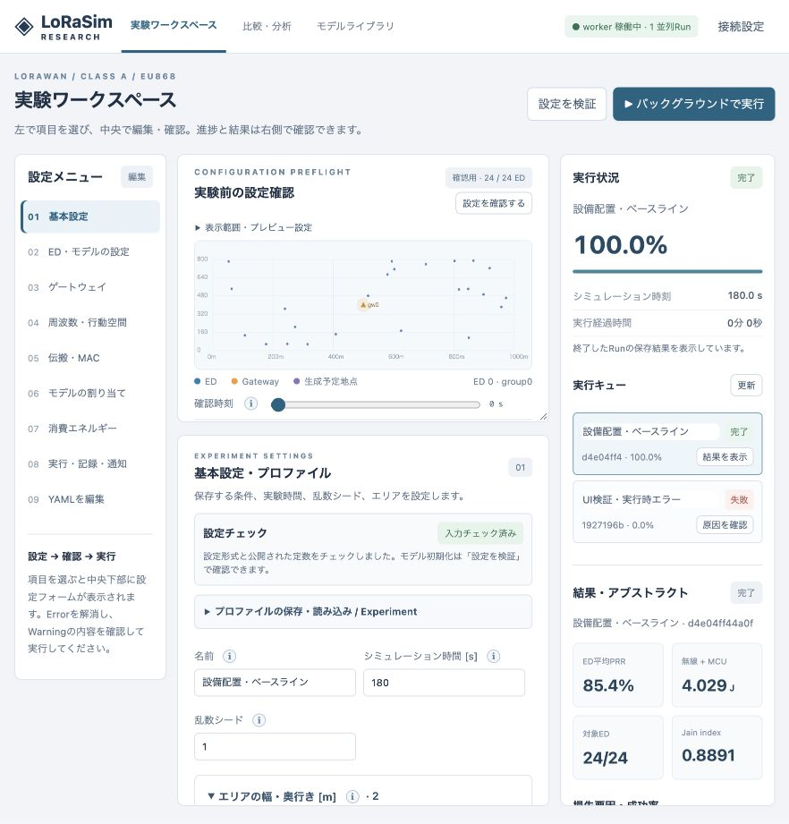
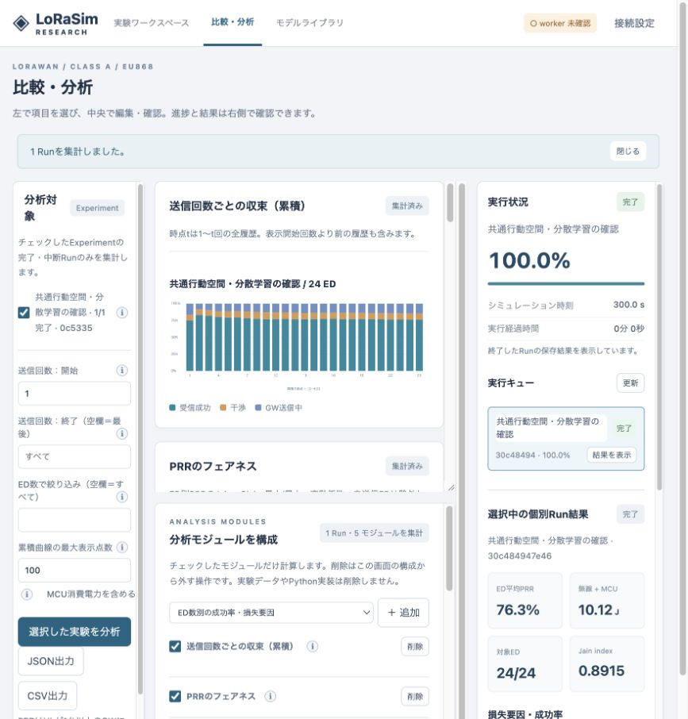

# LoRaSim Research

Class A LoRaWAN研究用のPythonシミュレーターです。ns-3のLoRaWANモジュールを読み、伝搬・送信時間・SF間干渉・PHY受信制約を移植し、プログラマブルなED、管理GUI、独立ワーカー、ストリーミング出力を組み合わせています。

**v0.14.0。ns-3全体との完全互換を保証するものではありません。** 対象はEU868 / BW 125 kHz / LogDistance / GoursaudまたはALOHA干渉モデルです。適用範囲と上流との差分を [FIDELITY.md](docs/FIDELITY.md) に記載しています。実験で使う前に、この条件が研究目的に合うことを確認してください。

## v0.14.0の追加

TVT評価向けのExperiment YAML 76本と短い機能確認例を `examples/tvt/` に追加しました。GUIから同梱YAMLをプルダウンで読み込み、移動・送信・選択器の追加プラグインと、PRR・公平性・推論時間・移動遷移等の7分析モジュールを選べます。[設定・実行・評価手順](docs/TVT_GUI_EXPERIMENTS.md)。PHY/MACの計算は維持し、測定用にschema_version=5の列・表を追記しています。

「比較・分析」にAIコンサルタントを追加。選択したRunの集計結果・モデル条件・分析範囲をもとに継続会話できます。OpenAIのエンドポイント・API形式・APIキー・モデル・出力上限・待機時間をGUIから保存し、回答をストリーミング表示します。Calculatorの既存相談も共通化しました。長い時系列は省略箇所を明示して標本化し、相談ごとに再集計しません。

[接続・操作・データ仕様](docs/AI_CONSULTANT.md)、[検証記録](docs/VALIDATION-v014.md)。外部OpenAI APIへの実接続試験は未実施です。

## v0.13.0の追加

「モデルライブラリ」にハイパーパラメータ調整を追加しました。Optionsからの項目候補、線形・対数範囲、段階的絞り込み・焼きなまし型局所探索・網羅探索に対応します。PHY/MACとED数を保ち、短い評価へ予算を配分。別seedで選択候補と元定義を確認し、新しいモデル定義として保存できます。バックグラウンドworkerと既存の並列Run枠を共用します。

[使い方・評価式・限界](docs/TUNING.md)、[小規模な登録例](examples/tuning_bandit.py)、[検証記録](docs/VALIDATION-v013.md)。探索中はAPIとworkerを同じリリースで運用してください。

## v0.12.0の追加

比較・分析を15モジュールへ拡張しました。ED数別の数値一覧・PRR折れ線、位置別SF地図、SEMAの残存履歴、距離別の静止時PRR、CH分布のKL/JS、静止/移動別成績を追加。収束は連続した積み上げ面グラフになり、ホバー・標本数・数値ラベル・表CSVを利用できます。

名前入力に「名称を反映」、事前確認に「Abstruct · 設定一覧」、上部に「ドキュメント」を追加しました。[操作ガイド](docs/GUI.md)、[指標の定義](docs/RESEARCH_ANALYSIS.md)、[文書一覧](docs/INDEX.md)、[検証記録](docs/VALIDATION-v012.md)。新規Runは追記型のschema_version=4で、旧結果の不足する履歴は推測しません。

## v0.11.0の追加

Calculatorに「経験分布」を追加。移動×送信タイミングが各EDに与える地点別の経験候補を確認できます。静止・移動の回数、同一静止地点への集中率、連続経験、時間順の内訳、送信地点と滞在分布の地図を表示し、設定した集中基準でEDを抽出します。選択器は動かさず、偏った条件を作って比較実験するために使用します。[仕様・使い方](docs/EXPERIENCE_DISTRIBUTION.md)。例：`examples/19-experience-bias.yaml`。

## v0.10.1の修正

AIコンサルタントの既定接続先をOpenAI APIにしました。サーバーの `.env` に `LORASIM_AI_MODEL` と `LORASIM_AI_API_KEY` を設定し、APIコンテナへ反映して利用します。キー・モデル未設定、出力上限・URL不正、APIの認証・利用枠エラーを日本語で案内します。[OpenAI接続手順](docs/AI_CONSULTANT.md)。

## v0.10.0の追加

Calculatorへ「トレードオフ予測」「AIコンサルタント」を追加しました。

- プロファイルから、干渉・GW送信中・感度未満などのUL損失を近似し、SF・CH・TP・送信間隔・ED数・ACK有無の変更を比較します。GW送信によって隠れる潜在干渉も表示します。
- 全送信履歴を生成せず、標本化した配置とPoisson重複電波・ACK可用性を計算します。予測の仮定・未対応機構・収束状態を明示します。
- 現在の条件や保存済みRunを、任意のChat Completions互換AIへ相談できます。送信前にデータを表示し、キーはサーバー環境変数で設定します。未設定でも他の機能は利用できます。

[予測の数式・使い方](docs/TRADEOFF_FORECAST.md)、[AI接続手順](docs/AI_CONSULTANT.md)、[本体との比較検証](docs/VALIDATION-v010.md)。例は `examples/18-tradeoff-planning.yaml`。PHY/MACと実験結果の計算は変更していません。

## v0.9.2の修正

- 更新時に新しいHTMLと古いJavaScript/CSSが混在し、Calculatorが開かない問題を修正。画面ファイルの内容に応じてURLを更新します。
- 配置プレビューはエリアの縦横比を保持し、文字・点の引き伸ばしを解消。画面サイズ・表示倍率に合わせて再描画し、EDクリックの位置も一致させます。
- シミュレーションとCalculatorの計算式は変更していません。[検証・更新方法](docs/VALIDATION-v092.md)。

## v0.9.1の変更

「実験前の設定確認」にCalculatorを追加しました。TP・SF・CRを指定して、距離と受信電力の曲線、受信感度との交点、指定距離での電力余裕、送信時間を確認できます。本体と同じPHYを使い、実験のイベント処理には負荷を追加しません。[操作・数式・検証](docs/CALCULATOR.md)。

## v0.9の変更

- Waypointを共通の有限地点集合上の独立ランダム移動に対応。初期地点、目的地、出発速度、到着後の静止時間を各EDで抽選します。地点数と上下限をGUIで設定できます。
- D-LoRaのCF/SF/TP別CUCBを追加。表IIIの既定値と式19〜24に対応し、ACK観測との差分をWarningと仕様書に明記します。
- ADR・BADR・G-ADRの旧制御モードでも、送信試行ごとの一様ランダムCH選択を追加。共通行動空間では従来どおり候補CHを一様選択します。
- LMLoRa・HybridQ-ADRはユーザーの指示により今回は追加しません。

[Waypoint仕様](docs/WAYPOINTS.md)、[D-LoRaの数式対応と再現境界](docs/PAPERS_V09.md)、[検証記録](docs/VALIDATION-v09.md)。実行例は `examples/10-random-waypoints.yaml`、`16-d-lora-waypoints.yaml`、`17-adr-random-channels.yaml`。

## v0.8の変更

- ADR・BADR・G-ADRへ共通行動空間を注入。GUIからSF/CH候補とTP/CR固定値を設定できます。原制御との差分を画面とWarningで明示します。
- GUI右側に複数Runの同時実行数、稼働数・待機数を表示。独立プロセスの起動上限を実行中に変更し、保存します。
- 共通空間を指定しない旧プロファイルの制御、PHY/MACの計算とイベント順序を維持します。

[制御則と比較条件](docs/ADR_COMPARISON.md)、[並列実行の運用](docs/OPERATIONS.md#v08-guiから複数runを並列実行)、[検証記録](docs/VALIDATION-v08.md)。例: `examples/15-adr-common-space.yaml`。

## v0.6の変更

- Errorを日本語の原因説明・対処ヒント・元の技術詳細で表示。実行中の失敗もRunに保存します。
- 設定の自動チェックと、物理層・学習条件・通知失敗に対する非ブロッキングのWarning。
- 左を設定メニュー、中央上をプレビュー、中央下を設定フォーム、右を実行進捗と結果に整理。上下パネルは独立してスクロールできます。
- 物理層・MAC・イベントの理論と計算方式は変更していません。

[操作と診断仕様](docs/DIAGNOSTICS.md)、[検証記録](docs/VALIDATION-v06.md)。

## v0.5の変更

- 実験共通のSF×CH行動空間。登録済みのUL中心周波数からCHを選択し、SFと直積にします。
- 原手法とは別の `linucb_sf_ch` / `lora_mab_sf_ch`、一様ランダムの `random_sf_ch`。
- 添付修士論文に基づく `sema` と同一の下位学習器による `dqn`。ハイパーパラメータはGUI/YAMLで変更できます。
- 遷移確率行列、自己滞在、拠点間速度を指定する `markov` 移動。
- DL到着順の配列化・再利用と、移動モデルの静止区間の再利用による追加高速化。

[SEMA/DQNと共通行動空間](docs/SEMA.md)、[マルコフ移動](docs/MARKOV.md)、[検証と性能測定](docs/VALIDATION-v05.md)。すぐ試せる例は `examples/12-sf-ch-comparison.yaml`、`13-markov.yaml` です。

## v0.4の変更

- DL到着処理の集約、静止リンクの再利用、ランダムウォークの配列計算で高速化。
- 試験機能として1実験内のArrow/Parquet保存を複数CPUプロセスで処理。GUIの「実行方式・高速化」で設定。
- 一様ランダムWayPoint、速度と揺らぎ、地点ごとの静止時間と到着ごとの揺らぎ。
- 添付原論文に基づくLinUCB-SF、LoRa-MAB、G-ADR。SF×TPは明示的に分離した研究拡張。

[高速化と計測方法](docs/PERFORMANCE.md)、[論文との対応・未指定事項](docs/PAPERS.md)、[検証結果](docs/VALIDATION-v04.md)。実行例は`examples/09-fast-multicore.yaml`、`10-random-waypoints.yaml`、`11-paper-selectors.yaml`。

## v0.3の変更

- 内蔵・独自モデルの共通インターフェース、型付きOptionsによるGUIへの定数公開。
- グループ別の周期・初回時刻（一様分布/固定）、日本語ラベルと説明ツールチップ。
- 自動採番、UL/DL許可サブバンド、登録チャネルからの周波数選択。
- 実験前プレビュー専用の中央パネル、モデルライブラリの一覧・編集・複製。
- Experimentの実行時刻・実時間・実行環境をinfoで確認。

既存YAMLと旧importパスは維持します。新しい例は `examples/07-preflight-sub-bands.yaml`、独自モデルは `examples/exposed_models.py` です。[開発ガイド](docs/PLUGINS.md)と[検証記録](docs/VALIDATION-v03.md)を参照してください。

## 起動（Ubuntu 22.04 / Docker Compose）

Docker EngineとComposeプラグインが利用可能な環境で、このディレクトリに移動して実行します。

```bash
docker compose up -d --build
docker compose exec api lorasim import-examples --data /data
```

管理画面: <http://localhost:8000>。`api`と`worker`は別コンテナで、ブラウザ／SSH切断後も動作します。サーバーが別端末なら `ssh -L 8000:localhost:8000 user@server` で接続してください。初期設定はlocalhostのみ公開します。

1. 保存済みプロファイルから例を選ぶ。
2. 左側のメニューで項目を選び、中央下部の設定フォームで編集する。YAMLの直接編集も可能。
3. 中央の「設定を確認する」で配置・移動・生成予定時刻・モデル定数を確認する。
4. Experimentを選び、「設定を検証」「保存」「バックグラウンドで実行」を押す。終了後に右側のアブストラクトを確認する。
5. 「比較・分析」でExperimentを選び、送信回数範囲、フェアネス、MCU有無を指定する。

`.env.example`を`.env`へコピーするとワーカー数等を変更できます。`LORASIM_WORKERS=4`は**独立した実験を4プロセスで実行**します。一つの無線ネットワークのイベントを非同期に並列化して因果関係を変えることはしません。

```bash
docker compose exec api lorasim submit examples/03-mobile-learning.yaml --data /data
docker compose exec api lorasim sweep examples/01-small.yaml --seeds 1 2 3 4 --data /data
docker compose exec api lorasim jobs --data /data
# 全結果をホストへコピー（停止不要）
docker compose cp api:/data/runs ./runs
# 停止。-v を付けなければ結果ボリュームを保持します。
docker compose down
```

## Pythonのみで実行

```bash
python3 -m venv .venv
. .venv/bin/activate
pip install -e '.[test,analysis]'
lorasim run examples/01-small.yaml --output runs/small
lorasim run examples/02-collisions.yaml --output runs/collisions
lorasim run examples/03-mobile-learning.yaml --output runs/mobile
pytest -q
```

`run`は前景実行です。SSH切断に耐える運用では、別ワーカーを使用します。

```bash
lorasim import-examples --data data
lorasim start-worker --data data --workers 2
lorasim serve --data data --host 127.0.0.1 --port 8000
# 別ターミナル
lorasim submit examples/01-small.yaml --data data
```

`start-worker`はstdinを切り離した新セッションで起動し、ログを`data/worker.log`へ出します。OSのログアウト時プロセス削除ポリシーまで避ける必要がある環境は、Composeまたは [systemd例](deploy/lorasim-worker.service) を使います。ホスト停止後にシミュレーション途中から再開するチェックポイントはありません。部分Parquetを保存し、失われた実行を`interrupted`として扱います。

## 機能

| 要件 | 実装 |
|---|---|
| Class A | TX→RX1→RX2、ACK、再送、RX中のウィンドウ延長、GW半二重 |
| 送信ごとのSF/TP/CR等 | 方策`select(Observation)`、受信結果`observe(Feedback)` |
| 方策割り当て | グループ、タグ、ED ID条件、後勝ち上書き |
| ED観測 | ACKの成否、成功したDLのRSSI、自己送信設定、任意で自己位置 |
| 送信タイミング | periodic、poisson、Python拡張 |
| 移動 | 静止、waypoints、反射境界random_walk、Python拡張 |
| GUI / YAML | 定数公開フォーム、日本語の説明、モデルライブラリ、実験前プレビュー、全文エディター |
| 再利用 | モデル定義YAML / ref、実行時スナップショット、開発者API |
| 比較アルゴリズム | 上流ADRサーバー計算、模擬LinkADRReq、端末backoff、Blind ADR |
| 消費電力 | 上流無線モデルの状態積分・線形TX電流、別立てMCU推論/学習 |
| バックグラウンド | SQLite永続キュー、独立プロセス、進捗・キャンセル |
| 通知 | 非同期curl POST、割合閾値、終端通知、結果ログ |
| 計測 | UL/DLごとの送信、GW/ED受信、損失要因、受信電力、伝搬損失 |
| 分析 | Experiment単位、ED数別/送信回数別損失、PRR、Jain/Gini/CV、エネルギー、JSON/CSV |
| デプロイ | Ubuntu 22.04 Dockerfile、Compose、任意GPUワーカー |

実行済みの小規模結果を [sample-results/small](sample-results/small) に同梱しています。

## 比較実験をすぐ実行

```bash
lorasim run examples/05-adr-energy.yaml --output runs/adr-energy
lorasim run examples/06-badr-mobility.yaml --output runs/badr-mobile
python scripts/seed_comparison.py --data data --counts 20 40 60 --seeds 1 2
lorasim worker --data data --workers 2 --once
```

BADRはSemtechのBlind ADRとして実装しています。LoRaWAN標準が使用順序を一意に決める方式ではないため、比較に使ったSF列を明示してください。無線電力は上流の既定値を使用しますが、MCUの電力・時間は対象ハードウェアに合わせて設定します。



## 読む順序

- [モデルの根拠・適用範囲・相違点](docs/FIDELITY.md)
- [プロファイル・プラグイン・GPU利用](docs/CONFIGURATION.md)
- [プラグインとGUI設定公開（v0.3）](docs/PLUGINS.md)
- [観測・学習・再利用の開発者マニュアル](docs/DEVELOPER.md)
- [ADR / BADRの定義と範囲](docs/ALGORITHMS.md)
- [無線・MCU消費電力の式と検証](docs/ENERGY.md)
- [Experiment管理・分析仕様](docs/ANALYSIS.md)
- [パケットトラッキング仕様と分析](docs/TRACKING.md)
- [実施した検証と性能測定](docs/VALIDATION.md)
- [運用とデータ保全](docs/OPERATIONS.md)

上流ソースに基づく改変コードを含むため、ライセンスは **GPL-2.0-only** です。[NOTICE](NOTICE) と [LICENSE](LICENSE) を参照してください。


## v0.7: ED独立性・共通行動空間・分析モジュール

EDごとのQ表・学習状態の独立性を検証し、SF×CH×CR×TPの全体集合からED側の部分集合を選択器へ渡す契約を追加しました。`bandit`や`lora_mab`の名前を変えずに216候補、CR/TP固定の18候補などを設定できます。旧プロファイルは互換読み込みします。

- [行動空間とEDの独立性](docs/ACTION_SPACE.md)
- [分析モジュール開発ガイド](docs/ANALYSIS_PLUGINS.md)
- [分析モジュール・定義・文献](docs/METRICS.md)
- [検証結果](docs/VALIDATION-v07.md)
- [実行例](examples/14-unified-action-space.yaml)

比較・分析は中央上部に結果、下部にモジュールの追加・削除・トグル・定数を配置しました。収束は時点tまでの全履歴を使う累積割合です。


