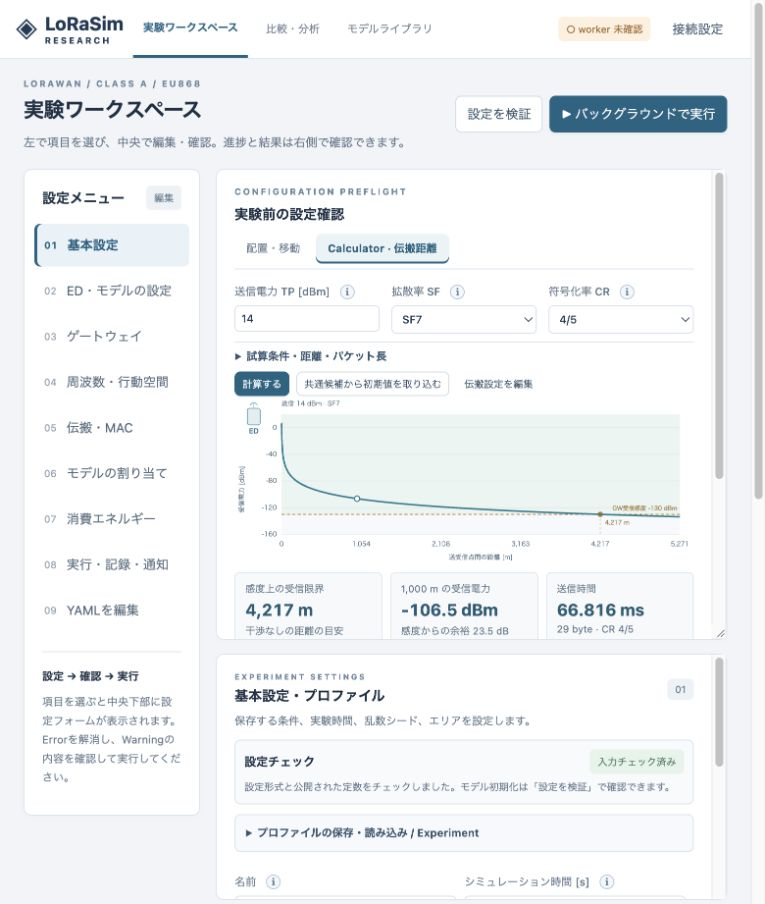

# 伝搬距離 Calculator（v0.10.0）

実験ワークスペース中央上部の **実験前の設定確認 → Calculator → 伝搬距離** で利用します。実験やworkerを起動する必要はありません。

v0.10.0では同じCalculator内に [トレードオフ予測](TRADEOFF_FORECAST.md) と [AIコンサルタント](AI_CONSULTANT.md) を追加しています。

## 更新時の表示不具合への対応（v0.9.2）

APIと画面ファイルを含む修正版に更新してから、ブラウザーを通常の方法で再読み込みしてください。サーバーが配信するHTMLは保存させず、JavaScript/CSSのURLには内容のハッシュを付けます。以前の画面ファイルがブラウザーに残っていても修正版を取得します。`/static/index.html` を直接開いた場合も同じ入口に戻します。

「配置・移動」はx・y方向を同じ縮尺で描画します。正方形のエリアは正方形、長方形は設定した比率で表示します。余った幅は余白とし、文字や点を横方向へ拡大しません。Canvasの描画解像度とクリック判定も表示サイズに追従します。[回帰検証](VALIDATION-v092.md)。

## 操作

1. 送信電力TP・SF・CRを入力します。初回は共通行動空間の各先頭候補を使います。「共通候補から初期値を取り込む」で再取得できます。
2. 曲線は距離に対する受信電力、破線は受信感度、交点は感度上の受信限界です。左のアイコンは送信側。横軸は高さの違いも含む送受信点間の**直線距離**です。
3. 「試算条件・距離・パケット長」で、UL/DL、確認距離、横軸の最大距離、必要な余裕、PHYパケット長を設定できます。最大距離が空欄なら表示範囲を自動調整します。
4. グラフ下に受信限界、確認距離での受信電力・感度からの余裕、送信時間を表示します。表示範囲外の交点は端へ丸めず、その旨を明記します。至近距離でも感度を満たさない場合は「感度条件を満たす距離なし」と表示します。
5. 「伝搬設定を編集」で中央下部の伝搬設定に移動します。伝搬指数・基準距離・基準損失の変更はCalculatorにも反映されます。

Calculatorの無線値は**試算専用**で、選択器・共通行動空間・実験YAMLに書き戻しません。実験で使う値は通常の設定画面で指定し、プロファイルを検証してください。試算はモデルの動作やサブバンドの電力上限を含む実験全体の検証を代替しません。未適用のYAML編集は「GUIに反映・検証」するまで使用しません。

## 本体との対応

計算は `lorasim/calculator.py`、UIは `lorasim/static/calculator.js`。本体と同じ `phy.links`、`GW_SENSITIVITY` / `ED_SENSITIVITY`、`phy.airtime_ns` を使用します。曲線の数式をJavaScriptへ別実装していません。

```text
PL(d) = L₀ + 10 n log₁₀(max(d/d₀, 1))
RSSI(d) = TP − PL(d)
必要な受信電力 = 受信感度 + 試算用マージン
d_limit = d₀ × 10^((TP − L₀ − 受信感度 − マージン)/(10 n))
```

至近距離の `TP − L₀` が必要な受信電力を下回る場合、逆算式は使わず「該当距離なし」とします。等号は本体と同じく感度条件を満たします。マージンの既定値は0 dBで、本体の判定条件は変更しません。

ULはGW、DLはEDの感度を使います。帯域幅は125 kHzです。現行モデルにないCRの感度改善・符号化利得や、周波数による追加の伝搬補正は加えません。**CRを変えると送信時間は変わりますが、受信電力・受信限界は変わりません。** PHYパケット長は送信時間だけに使います。既定値は最初のEDグループのアプリケーションペイロード＋9 byte。ADRコマンド等があれば総長を手入力してください。

距離の目安は無干渉での感度条件です。成功率、干渉、受信窓、GW送信中、復調器不足、ACK往復の成功は計算しません。建物・フェージング等、現行モデルにない機構も追加していません。[理論境界・固定した上流](FIDELITY.md)を参照してください。

## 実行負荷・API

- `POST /api/calculator`。既存APIと同じBearer認証を適用します。
- プロファイル全体や独自プラグインを読み込まず、Run登録・モデル生成・乱数消費・結果保存を行いません。
- 曲線は最大453点。計算量とメモリはED数・実験時間に依存しません。
- 入力変更は300 msまとめて計算します。別タブ・別画面への切替、ブラウザ非表示で新しい試算を停止し、古い応答は表示へ反映しません。
- 表示距離は最大10,000,000 m。グラフの保護上限であり、モデルの受信限界を切り詰めません。数値表現限界は無限大をJSONに返さず別状態として表示します。

入力例：

```json
{
  "channel": {"exponent": 3.76, "reference_distance_m": 1, "reference_loss_db": 7.7},
  "radio": {"sf": 7, "tp_dbm": 14, "cr": 1},
  "direction": "uplink",
  "probe_distance_m": 1000,
  "max_distance_m": null,
  "margin_db": 0,
  "phy_bytes": 29
}
```

## Calculator追加時の検証（v0.9.1 / 2026-10-19）

macOS arm64 / Python 3.11.4：全 **259テスト通過**、11.28秒。[ログ](../validation/tests-calculator-native.txt)。既存Starlette TestClientの非推奨警告1件。

追加18件では、scalar PHYとの一致、全6SF・両受信側の感度、任意の伝搬設定とマージン、CRとToA、感度境界・感度未達・表示範囲外、極端値の有限応答、API認証、入力診断、モデルを生成せずRunも登録しないことを検証しました。

ブラウザではタブ切替、TP/SF/CR、伝搬設定との連動、感度未達、日本語Errorとヒント、DL・マージン・表示範囲外を確認しました。既定条件のUL / TP14 dBm / SF7は約4217 m、1000 mの受信電力−106.5 dBm。PHY29 byteでCR4/5は66.816 ms、4/8は94.464 msで距離は同じ。SF12では約9066.6 mです。

今回はローカルGUI・Pythonテストで検証し、Ubuntu実機・GPU測定や稼働中サーバーへのデプロイは行っていません。




v0.11.0では「経験分布」を追加しました。移動と送信タイミングが、各EDに偏った地点経験を与えるかを実験前に確認できます。[仕様・数値例・使い方](EXPERIENCE_DISTRIBUTION.md)。
