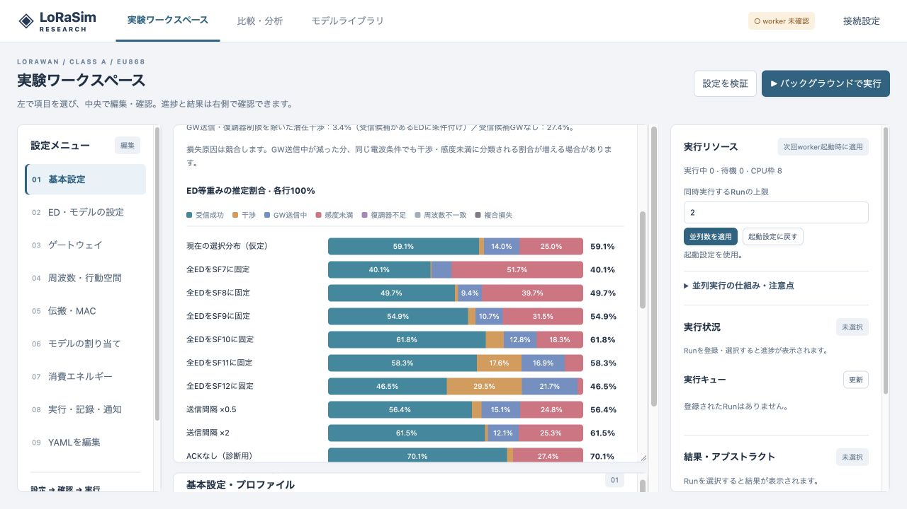

# v0.10.0 検証記録

2026-10-20。Calculatorにトレードオフ予測とAIコンサルタントを追加。既存のPHY/MAC・移動・学習・記録の計算は変更していない。`engine.py` の変更はmanifestのバージョン文字列のみ。

## 自動検証

- macOS arm64 / Python 3.11.4：**284 passed**、9.54秒。[ログ](../validation/tests-planning-v010.txt)。既存のStarlette TestClient非推奨警告1件。
- CanvasのJavaScript回帰検証：**6 passed**。[ログ](../validation/tests-planning-ui-v010.txt)。
- JavaScript構文チェック、`git diff --check`、`docker compose config -q` 通過。

追加22件で、以下を検証した。

- 1台のClass A EDが自分自身や自分のACKでULを失わない。
- Poisson重複サンプリングがPure ALOHAの `exp(−2λT)` に整合する。
- 単独では弱い干渉波でも加算エネルギーで失敗を起こす。ALOHA時は異SFを除外する。
- 感度未満・周波数不一致・ACK無効・複数GWのMixedLossを区別する。
- 全原因の割合が合計1、GWのDuty Cycle占有が制約内、CH分散で干渉が減る。
- 同seedの再現性、入力非破壊、送信回数に比例しない計算、処理上限のエラー。
- 同期・学習分布・開始時刻不整合の診断。直積の列挙順、固定器のRadioが実モデルと一致する。
- GW送信有無による損失構成の変化と、潜在干渉・感度条件の不変性を区別する。
- API認証の継承、Runを作成しないこと。
- AI未設定、送信データの除外とサイズ上限、保存Runのスナップショット、HTTP要求、APIキー非露出、日本語のエラー、模擬サービスの応答。

## 本シミュレーターとの照合

全て500 ED、seed=4、周期600秒、開始位相Uniform(0,600)、18000秒、1 GW、最大試行1回、Duty Cycle有効、無線エネルギー記録無効。予測は128標本ED・512重複試行・比較行なし。本体は条件ごとに約15,000 ULを処理した。SF7/SF12の行は2 km四方・1 CH・TP14、混合の行は10 km四方・SF7〜12×3 CH一様・TP14。GWはエリア中央。

| 条件 | 予測平均UL成功率 | 本体平均UL成功率 | 最大の原因割合差 | 予測実時間 | 本体実時間 |
|---|---:|---:|---:|---:|---:|
| SF7・ACKあり | 83.70% | 81.43% | 2.26 pt | 0.108秒 | 1.168秒 |
| SF12・ACKあり | 20.50% | 19.11% | 6.23 pt | 0.091秒 | 0.934秒 |
| SF/CH混合・感度境界あり | 70.14% | 69.82% | 0.88 pt | 0.365秒 | 1.070秒 |
| 同条件・ACKなし | 83.08% | 83.61% | 0.53 pt | 0.109秒 | 0.873秒 |

[入力・推定・本体結果のJSON](../validation/planning-comparison-v010.json)。これは小規模な実装照合であり、全条件の精度保証・対象Ubuntu/GPUのベンチマーク・アルゴリズム優劣の比較ではない。

全台SF12ではGW送信中が予測17.88%、本体24.11%で、6.23ポイント過小評価した。干渉は予測61.61%、本体56.78%だった。総成功率だけが近くても原因の内訳がずれることがあるため、実験条件の絞り込みに使い、最終確認は本体で行う。

## ブラウザー

ローカル専用領域で500台の例 `18-tradeoff-planning` を読み込み、Calculatorの3つの機能切替、予測ボタン、15条件の積み重ねグラフ・数値表・前提・日本語診断を確認した。GUIでの3回の計測は1.59〜1.78秒。既存の伝搬距離計算も表示された。

AI画面では未設定の案内、相談対象、送信前JSON、キー未設定時に送信できないことを確認した。外部AIへの実データ送信は行っていない。模擬サービスでAPI要求・応答をテストしており、実際の提供元のモデル・アカウントでの接続確認は利用時に必要。

## 更新

ソースを更新して、実験が完了してから `docker compose up -d --build` でAPI/workerを更新する。ブラウザーは通常の再読み込みで更新ファイルを取得する。AIは `.env` に接続先URL・モデル・必要ならAPIキーを指定する。未設定でも予測と通常の実験は利用できる。

稼働サーバーへの反映とUbuntu実機・CUDAでの確認は今回行っていない。
