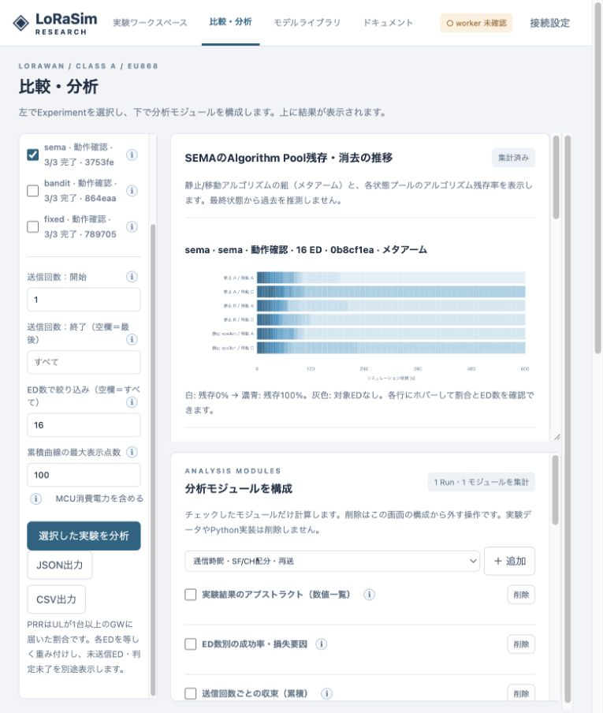
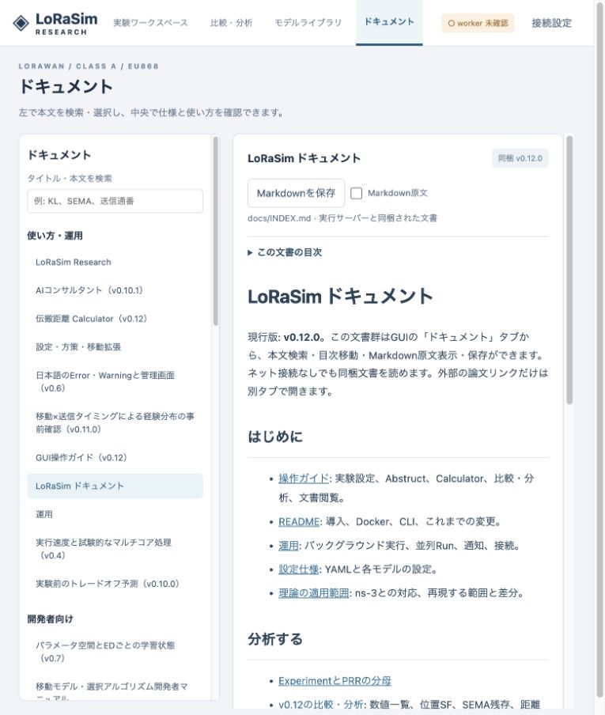

# v0.12.0 検証記録

本記録はv0.12の追加分析・GUI・ドキュメント機能を対象とします。検証環境は開発端末macOS / Python 3.11です。指定Ubuntuカーネル・NVIDIA GPU上での再測定ではありません。

## 数値と互換性

手計算の小規模Parquetで、ED等重みとパケット重みの差、Run等重みのPRR折れ線、SF最頻値/割合、範囲指定、静止距離の累積/区間PRR、旧列欠落、KLの相殺例・ゼロ確率・無限大、JSの一致/非重複分布、SEMAの個別/全体残存を確認します。

SEMAを記録あり/変更記録なしで同じseedから実行し、transmissions/uplinks/receptions/feedbackおよび最終学習状態が一致することを確認します。過去からの最適化・PHY/MACの等価性テストも全体テストに含みます。

## GUIと文書

実際のAPIとブラウザで名称反映、3つの事前確認タブ、比較分析、モジュール追加、図・表、文書検索/リンク/原文表示を確認します。画面検証用の9 Run（8/16/32 ED × fixed/bandit/sema）は動作確認用であり、方式の優劣を主張するベンチマークではありません。

文書の読み取りパス制限・認証・HTML無効化、ローカル文書リンクの変換、wheelへの同梱をテストします。

## ログ

- [Pythonテスト](../validation/tests-analysis-v012.txt)
- [JavaScriptテスト](../validation/tests-analysis-ui-v012.txt)

最終結果: **Python 327 passed / JavaScript 16 passed**。Python側に既存Starlette/httpx非推奨警告が1件あります。新規の失敗はありません。

9 Run・計10,073判定済みULで、全15モジュールの集計が完了しました（この開発端末で約0.51秒）。これは小規模の動作確認であり、大規模実験の時間予測ではありません。[記録](../validation/analysis-smoke-v012.json)。

ブラウザでは名称反映、Abstruct表示、PRR折れ線、位置SF、SEMAの時系列色表示と詳細値、静止距離PRR、KL/JS、文書検索・関連リンク・原文表示を確認しました。ブラウザのコンソールエラーはありませんでした。

DockerfileとGPU版に文書コピーを追加しました。今回Dockerサービスの再デプロイ、Ubuntu/NVIDIA実機での再検証は行っていません。

wheelを新しい仮想環境へインストールし、ソースツリーの外側から41文書の一覧・本文API・GUIシェルが読み込めることを確認しました。文書は`share/lorasim/docs`に同梱されます。[確認記録](../validation/wheel-documents-v012.json)。
