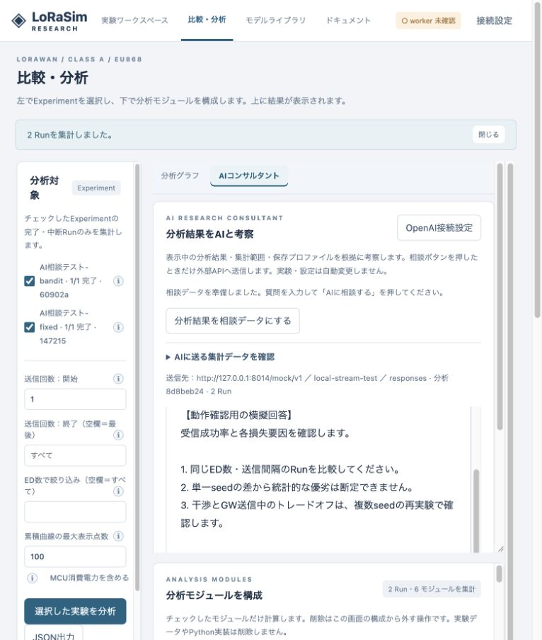
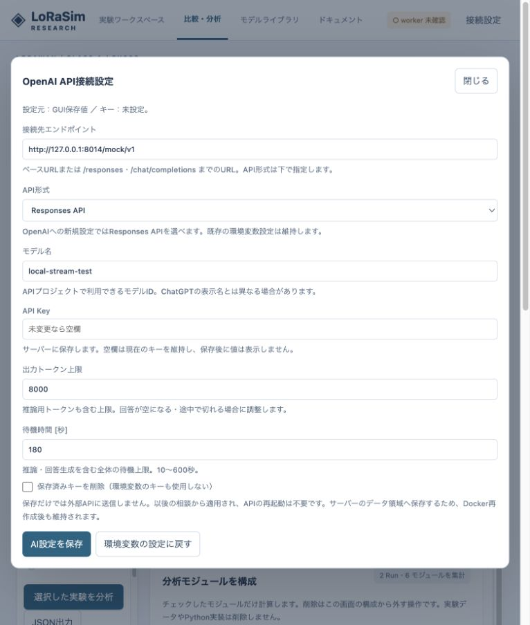

# v0.14 AI分析コンサルタントの検証

検証日：2026-10-20。ローカルmacOS / Python 3.11。外部OpenAI APIへの有料リクエスト、Ubuntu実機・Docker再デプロイは実施していません。通信テストはhttpx MockTransportとローカル模擬SSEを使用しています。

## 対象

- 選択Run・分析範囲・モジュール結果・保存プロファイルの固定スナップショット。未選択Runを除外し、未計測エネルギーを明示。時系列標本化、表の列対応維持。
- GUI接続設定の永続化、0600のキー保存、キー非返却、空欄維持・削除・環境変数への復帰、接続先変更時のキー再指定。
- Responses / Chat CompletionsのSSE差分・完了・利用トークン。履歴の役割・容量制限。UTF-8分割の受信。
- HTTPエラー、リダイレクト拒否、不正JSON、途中切断、出力上限、空の回答、キャンセル時の上流解放。秘密情報をエラーに転記しない。
- API認証が設定・スナップショット・ストリームへ適用されること。

## GUI確認

模擬データ4 ED × fixed/banditの2 Experimentを分析し、GUIからローカル模擬APIを設定しました。相談データの準備、回答表示、再読み込み後の接続設定保持を確認。これは通信・画面の確認であり、AIの分析精度や選択アルゴリズム性能の検証ではありません。

詳細な手順・制限は [AI_CONSULTANT.md](AI_CONSULTANT.md) を参照してください。

## 結果

- Python：**383 passed**、16.04秒。既存Starlette/httpx互換レイヤーの非推奨警告1件。記録：[Pythonログ](../validation/tests-consultant-v014.txt)。
- JavaScript：**22 passed**。記録：[UIロジックのログ](../validation/tests-consultant-ui-v014.txt)。
- Python wheelのビルド成功。依存にhttpxを追加し、SSEは非同期HTTPクライアントで処理。
- ブラウザー：ローカル模擬SSEからの部分テキスト到着→逐次表示→完了、継続質問、回答の停止→途中表示、新しい会話、設定の保存・再読み込み保持を確認。分析対象を変更すると相談データ準備と送信が無効化され、再分析が案内されました。
- 実行環境メタデータの版番号が旧版固定値だったため、今後のRunはパッケージの版番号を記録するよう修正。PHY/MACの制御・数式は変更していません。

画面内の回答は**模擬APIの固定文章**であり、OpenAIによる考察結果ではありません。

