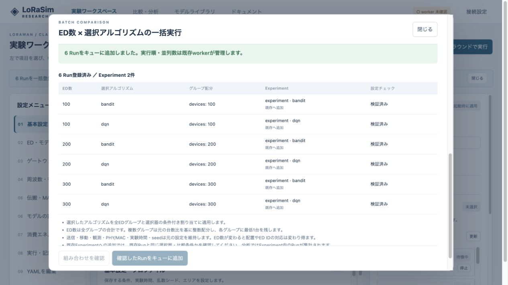

# v0.14.1 検証記録

2026-10-21、macOS / Python 3.11で検証。今回はED数×選択器の一括登録と運用文書を追加し、シミュレーションのPHY/MAC、移動、選択器、worker実行ループは変更していません。

## 自動検証

- 100・200・300 ED × Bandit・DQNが6 Run / 2 Experimentsとなり、既存Run形式で保存されること。
- 保存モデルの定数と共通行動空間の維持、複数グループの比率配分、選択器割り当ての置換、他の実験条件の維持。
- 設定違反、明示座標、ED ID割り当て、アルゴリズム前提不備の日本語Errorとヒント。
- 全候補検証後の原子的登録、DB書き込み途中失敗の全体ロールバック、同じ登録IDの同時再送と再試行、確認後の参照定義変更の検出。
- 既存workerで6 Runを実行し、既存の比較・分析へ受け渡すこと。

- Python: **400 passed**（18.69秒）。[ログ](../validation/pytest-v0141.log)。既存依存Starlette TestClientの非推奨警告が1件あります。
- JavaScript: **24 passed**。[ログ](../validation/ui-v0141.log)。
- `git diff --check`、JavaScript構文チェックに成功。

## ブラウザ確認

独立したローカルのテスト用データ領域で、100・200・300台とBandit・DQNをGUIから選択し、6行の確認表から一括登録しました。新規の2 Experimentへの3 Runずつの登録と、既存Experimentを選んだ追加登録を確認しました。登録前はキューを作らず、登録後に成功表示と通常の実行キューが更新されます。

## 旧workerとの互換性

変更前のGit HEAD（v0.14.0）を独立ディレクトリへ展開し、旧workerを別プロセスで起動しました。旧形式のRunが実行中にv0.14.1 APIから6 Runを投入し、APIインスタンスを作り直しました。

- 旧workerのsupervisor PIDは同一。
- API再作成中の既存Runはrunningを維持し、その後completed。
- 新APIから投入した6 Runもすべてcompleted、アルゴリズム別に2 Experiment。
- 全Runのmanifestは実際に処理したworkerのバージョン `0.14.0`。

[互換性試験の結果](../validation/batch-old-worker-v0141.json)。Dockerコンテナの本番再作成やNVIDIA GPUでの検証は今回行っていません。API・GUIだけの更新手順は [運用](OPERATIONS.md) を参照してください。新規チューニング探索の異版混在は対象外です。
