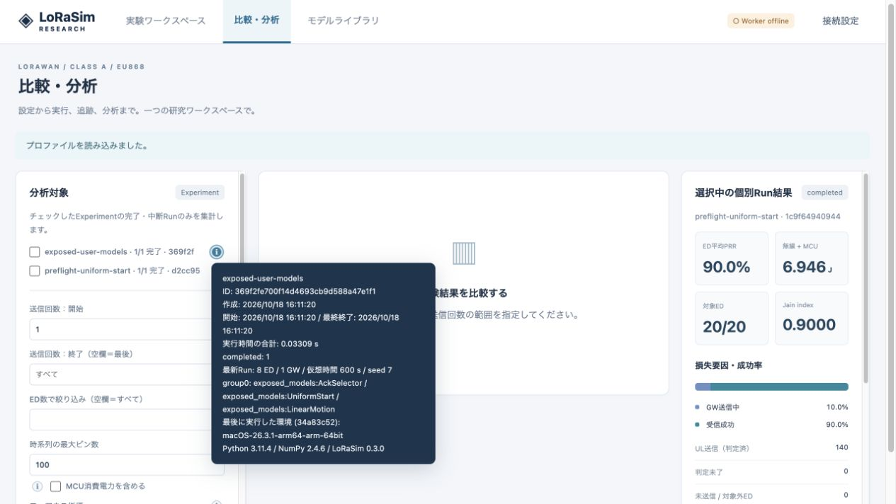

# v0.3 検証記録

検証日: 2026-10-18。以前のPHY・ADR・エネルギーの比較値は [VALIDATION.md](VALIDATION.md) を参照してください。

| 検証 | 結果 |
|---|---|
| 既存76件 + 新規11件（macOS / Python 3.11） | 87 passed |
| Ubuntu 22.04 / linux/amd64 / Python 3.10 のDocker内 | 87 passed |
| 既定値を含むプレビュー定数表示の最終修正後（native / Docker） | 関連11件を再実行、両方11 passed |
| Docker CPUイメージ | ビルド成功、パッケージ0.3.0、CLI起動確認 |
| 組み込みモデルと独自Options | 共通ローダー、カテゴリ型、入力範囲、独自コードの有効化制約を確認 |
| 初回生成時刻 | 一様分布の範囲、各EDの独立乱数、同一seedの再現性、実シミュレーションとプレビューの初回一致 |
| 互換性 | 旧periodicのfirst_s/random_phase、旧importパス、既存ADR・電力・分析テストを維持 |
| UL/DL | 許可外ULの拒否、無効なRX2の拒否、RX1禁止時のRX2 ACK受信とイベント記録 |
| プレビュー | 個数・反復上限、条件割り当て、独自モデル、結果ディレクトリを書き換えないこと |
| 自動採番 | 明示名を予約し、重複回避、保存後の再読み込みで名前を維持 |
| 実験情報 | 実行時間、Run条件、manifestの環境を概要APIで取得 |
| 実行例 | 07: 20 ED、08: 独自モデル8 ED、どちらも完了 |
| JavaScript | node --check 成功、ブラウザでGUI操作確認 |
| 例の登録 | Dockerで01〜07のimport-examplesとADR/BADR例の検証成功 |

Dockerの実行検証はBuildKitのRUN内で行いました。Docker Composeの常駐サービス起動と、NVIDIA GPU/CUDA/cuDNNでの実行は今回の検証に含みません。CPUイメージには新しいプラグインモジュールを含みます。物理層の計算式を変更した版ではなく、全ns-3機能との同等性や新たな速度向上倍率を主張するものではありません。

## ブラウザで確認した操作

- EDグループの周期送信に interval=120 s、start=uniform[0,90)を指定。ED 0で62.305, 182.305, 302.305…秒を表示。
- RandomWalkの速度をGUIから2 m/sへ変更し、軌跡を再確認。
- `exposed_models:UniformStart` をGUIへ読み込み、公開された生成間隔・開始上限のラベルと入力欄を確認。開始上限90秒の定義をライブラリへ保存。
- 例07のDL許可帯域から、RX2が `869.525 MHz · band1` の候補だけになることを確認。
- Run選択後も中央は設定確認用のまま、右側だけ結果を更新。
- Experimentのinfoへフォーカスし、実行日時・実時間・ED/GW数・OS・Python・NumPy・シミュレータ版を表示。
- JSから実行中の `/visualization` 呼び出しを削除。スライダーは既存サンプルを描き直すだけ。

追加回帰テストは `tests/test_plugin_configuration.py`。独自モデルの直接実行手順は [PLUGINS.md](PLUGINS.md) に記載しています。
