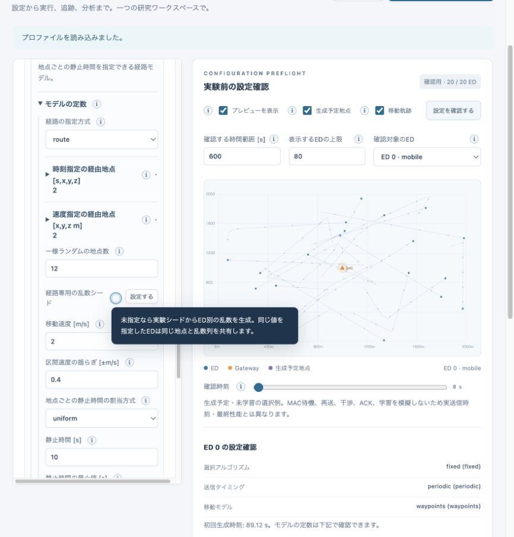
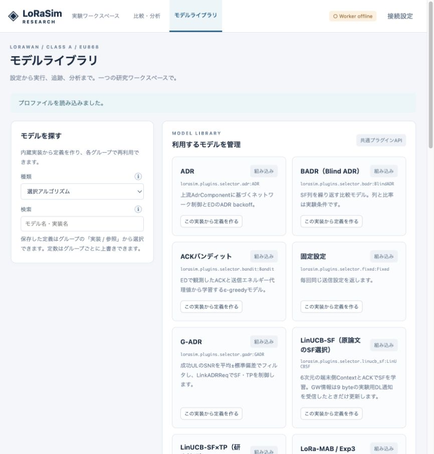

# v0.4 検証記録

実施日：2026-10-18。従来の無線モデルの検証は[VALIDATION.md](VALIDATION.md)も参照。

## 自動検証

- macOS arm64 / Python 3.11.4：**110 passed**（4.85秒）。
- Ubuntu 22.04 / linux/amd64 / Python 3.10、Docker BuildKit内：**110 passed**（33.64秒）。ホストはApple Siliconであり、amd64はQEMUエミュレーション。これは対象OSでの機能検証で、利用者の物理Ubuntu機の速度測定ではない。
- 試験イメージ：`lorasim-research:v04-tested-final`、image SHA `bd8ef078fce93018cc11ed546a3008c4955327a36139ceea516198ff03b35906`。
- 独立セッションのバックグラウンドワーカーから保存2プロセスを起動し、10,000 ULを完了。起動元のスクリプト終了後、GUI/APIなしで実行できることを確認。
- `docker compose config --quiet`成功。今回の検証ではComposeサービスの長期運用は実施していない。
- `examples/09-fast-multicore.yaml`、`10-random-waypoints.yaml`、`11-paper-selectors.yaml`：CLIで完走。Docker内でも3例とも完走。独立バックグラウンドワーカーの仕組みは既存構成を使用する。

テストには既存のns-3由来のPHY/energy検証、API/ジョブ/分析、全Options公開に加え、次を含む。

- 高速化ON/OFFで全7追跡テーブルを完全比較。静止、ランダムウォーク、従来waypoints、新しい周回routeを検証。観測位置あり、再送あり。通常の伝搬速度と1000 m/sの意図的に遅い伝搬で、到着の間にウィンドウ開始/終了や他イベントが入るケースを確認。
- 同一時刻・同一位置の到着、終了時刻での打切り。送受信件数とエネルギーも一致。
- 保存2プロセスと逐次保存の全列一致。保存失敗の親プロセスへの伝播。
- 経由地点の速度と静止時間、一様生成の領域、乱数再現性、周回履歴のサイズ上限。
- Exp3の手計算確率更新とACK失敗時の不変性。
- LinUCBの逆行列更新を独立した直接逆行列計算と照合。SNR gate、コンテキスト、再送予算、報酬、通知なしの情報遮断を検証。
- G-ADRの外れ値除外、標本分散、負のstepの0方向切捨て。
- 通知9 byteのDL長への反映。UL成功でもDL不達なら端末へUL SNR/RSSIを渡さないこと。

## 速度の実測

環境：macOS 26.3.1 arm64 / Python 3.11.4。同一プロファイル、固定選択器、500 ED、各40回、総UL 20,000、300秒周期・初回一様位相、Class A confirmed、全追跡・エネルギー計算有効。プロファイラなし。実験終了時の分析も含むシミュレーション実時間（セットアップ込みの時間はJSONにも記録）。

| 移動 | 逐次の従来実行方式 | 等価高速化ON | 高速化ON＋保存2プロセス | 高速化ONの比率 |
|---|---:|---:|---:|---:|
| stationary（3回の中央値） | 4.260 s | 2.257 s | 2.470 s | 約1.89倍 |
| random_walk（1回） | 62.694 s | 4.813 s | 4.894 s | 約13.03倍 |

生の結果：[静止](../validation/performance-v04-static.json)、[移動](../validation/performance-v04-mobile.json)。移動の最初の従来方式計測の冒頭に短いテスト実行も重なっているため、厳密な無負荷ベンチマークではない。移動条件は1回測定なので、利用環境で複数回確認すること。全パケットの時刻、RSSI、干渉積算、損失要因、ACK、エネルギーを含む**全7テーブルが完全一致**した。

今回の条件では保存プロセスを増やす追加効果は得られなかった。子プロセスのCPU時間は静止で約0.86〜0.89秒、移動で約0.90秒あり、複数CPUプロセスは実際に使用されているが、起動・データ転送の費用が勝った。したがって既定はwriter_processes=0。全コアを使い切る並列DESを実装したとは主張しない。

変更前v0.3から取得した別の20,000 ULのトレースとも、静止/移動双方で既存全列を完全照合した。既存列の追加前に照合しており、v0.4の通知列は従来モデルでは0/nullになる。

1 EDあたり20,000回（500 EDなら10,000,000 UL）の長期実測、利用者の実機CPU/CUDA、任意の独自MLモデルの推論速度は今回測定していない。上記値をその条件での完了時間と解釈しない。

## GUI確認

実ブラウザで09/10のプロファイルを読み込み、実行方式のON/OFF、保存プロセス数、ウェイポイントの速度・地点数・静止時間・揺らぎの入力欄と説明、経路プレビューを確認。ライブラリにG-ADR、LinUCB-SF、LoRa-MAB、SF×TP研究拡張が表示されることを確認した。

## 再現範囲

論文モデルの数式・更新とシミュレータへの統合を検証した。原論文の全実験図や改善率の再現は行っていない。LinUCB原典の未指定定数、報酬の値域と式の不整合、研究用DL通知形式、SF×TP拡張、G-ADRの履歴開始条件は[PAPERS.md](PAPERS.md)に明記している。
