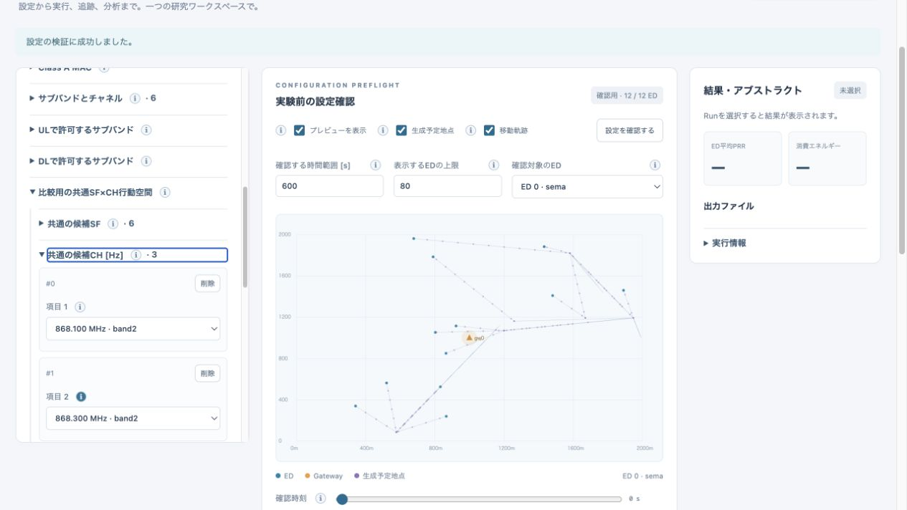
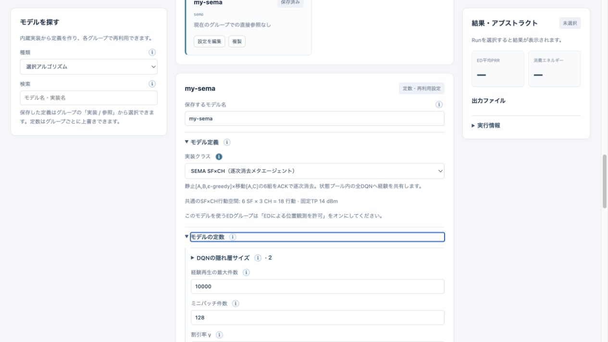

# v0.5 検証記録

実施日: 2026-10-18。比較元v0.4はコミット `9f4532df4e17749057065f136a223a136dec4ed7` の展開コピー。

## 自動検証

- macOS / Apple M2 / Python 3.11.4: **141 passed**（5.89秒）。[ログ](../validation/tests-v05-native.txt)
- Ubuntu 22.04 / linux/amd64 / Python 3.10: **141 passed**（44.17秒）。Apple Siliconホスト上のDocker BuildKit/QEMUによる対象OSの機能検証。[ログ](../validation/tests-v05-ubuntu22.txt)
- Dockerのベースイメージビルド、テストイメージビルド成功。検証イメージ `lorasim-research:v05-tested`、SHA `e764b66d403c753e411bf9709404c0d8b8a1f9f441615b4c7f4d32ee3f035c46`。
- 新規サンプル12/13はネイティブCLI・Ubuntuコンテナとも完走。ネイティブではそれぞれ480/359 UL。サンプル12ではDQN/SEMAの実際の勾配更新も確認。
- `docker compose config --quiet` 成功。Composeサービスの長期運用検証は今回実施していない。
- 従来のPHY/エネルギー、Class A、ジョブ、分析、API、保存並列化テストを維持。

追加検証は共通行動空間の次元・候補・制約、全新モデルのOptions公開、DQN勾配の有限差分照合、Adam初回更新の独立計算、Target同期、容量付き再生、ACK不達時の情報遮断、SEMAの状態別共有学習・逐次消去・未試行腕・ε-greedyリセット・時刻0の位置、マルコフ行列の検証・連続移動・吸収状態・問い合わせ頻度に依存しない乱数、プレビューのメモリ上限を含む。

新しい4学習モデル＋マルコフ移動でも、参照実行と高速実行で全7追跡テーブル・イベント数・最終モデル統計が一致。従来の通常／遅い伝搬速度、同時刻到着、終了時刻打切りの照合もすべて成功した。

## 実行時間

Apple M2 / macOS 26.3.1 arm64 / Python 3.11.4。同じプロファイルを旧版→新版の順で各1回実行。プロファイラなし。固定SF7、500 ED、300秒周期・初回一様位相、Class A confirmed、duty cycle有効、全追跡・無線エネルギー計算・最終分析有効。モデル初期化を含む実時間。保存は逐次。GUIと同じSimulationを使うCLIによる測定。

| 条件 | UL件数 | v0.4 | v0.5 | 短縮率 / 速度比 |
|---|---:|---:|---:|---:|
| 全ED静止 | 1,000,000 | 111.890 s | 89.273 s | 20.2% / 1.25倍 |
| ウェイポイント、20地点、3 m/s、到着後3,000秒静止、周回 | 20,000 | 60.512 s | 9.023 s | 85.1% / 6.71倍 |

[静止の生データ](../validation/performance-v05-static.json)、[移動の生データ](../validation/performance-v05-waypoints.json)。全7テーブルをParquetの部分ファイル単位で比較し、時刻、浮動小数点のRSSI/損失/距離/干渉積算、結果、ACK、エネルギー、行順がすべて一致した。静止条件の論理イベント数は99,590,986、移動条件は1,976,535で両版一致。

静止条件のプロセス最大RSSは旧版約105.8 MiB、新版約106.9 MiB（macOSのru_maxrss byte値）。移動条件は約100.0 / 105.3 MiB。追跡データを全件RAMに保持していない。

1回ずつの測定であり、OSキャッシュやホスト上の軽い編集・文書作成の影響を含む。重いテスト・別シミュレーション・Dockerビルドとは重ねていない。長時間静止する移動ほど座標再利用の効果が大きく、連続移動では同じ倍率を期待しないこと。ユーザー実機の「400万UL・約750秒」と同一プロファイル・ハードウェアでの測定ではない。400万ULの実機測定、CUDA/GPU実行、論文のPRR曲線の再現は実施していない。

## 管理画面

実ブラウザでサンプル12を読み込み、共通SF/CH設定、登録中心周波数のプルダウン、SEMAを含む経路・送信生成プレビュー、設定検証成功を確認。モデルライブラリでSEMAを選択し、各ハイパーパラメータの入力・説明、学習率0.005への編集と再利用モデルの保存を確認した。検証用データは独立した一時ディレクトリを使用。

## 論文対応の限界

修士論文の数式・構成・既定ハイパーパラメータを直接参照した。未記載の初期RSSI、減衰関数、乱数・初期化・同点処理等は [SEMA.md](SEMA.md) に区別して明記し、必要な定数を公開している。数式と統合の検証であり、論文の全実験結果の再現を意味しない。既存の無線モデルの適用範囲は [FIDELITY.md](FIDELITY.md) を参照。
