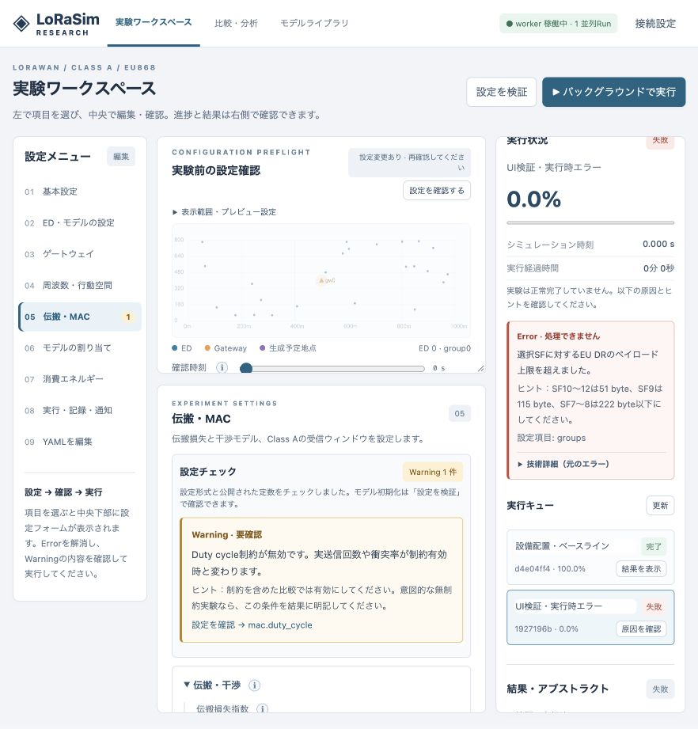

# v0.6 検証記録

検証日：2026-10-18。対象：日本語Error/Warning、入力診断、診断の永続化、管理画面レイアウト。

## 自動テスト

| 環境 | 結果 | pytest実行時間 |
| --- | --- | --- |
| macOS 26.3.1 / arm64 / Python 3.11.4 | 171 passed | 7.02 s |
| Ubuntu 22.04 / linux/amd64 / Python 3.10 / Docker BuildKit | 171 passed | 41.26 s |

Ubuntuの検証はApple Silicon上のQEMUエミュレーションです。実機UbuntuやGPUでの速度測定ではありません。両環境でFastAPI/Starletteのテスト用httpx連携に関する非推奨Warningが1件あり、テスト失敗はありません。

ログ：

- [ネイティブ実行](../validation/tests-v06-native.txt)
- [Ubuntu実行・実行例](../validation/tests-v06-ubuntu22.txt)
- [Docker本体ビルド](../validation/docker-build-v06.txt)

既存141件に加え、30件で次を確認しました。

- 型・数値上下限・NaN・未知のキー・YAML構文・設定パス。
- モデル定数、DQNバッチ容量、周期開始範囲、RX1/RX2、存在しないモデル。
- 既定設定にWarningがなく、既存のvalidate応答契約を維持すること。
- 100万ED設定の軽量チェックでSimulationやEDを構築しないこと。
- Warningを返しても保存・実行登録でき、Runへ診断を保存すること。
- モデル参照の上書き、条件割り当て、実際のホッピング候補に基づく周波数注意。
- リクエスト不正、認証、404/405、ディスク容量不足の日本語診断。
- 実行中のペイロード上限違反、ログを書けないときの元原因の保持、未知の独自例外の原文保持。
- 通知失敗を非致命的なWarningとして保存し、反復通知によって診断が増え続けないこと。
- 旧DBの列移行、保存済み中断Run、API/workerの同時起動に相当する並行移行。

Dockerでは同梱の `validation/Dockerfile.test` によるテストに加え、examples 05/06の検証、09/10/11/12/13のCLI実行を完了しました。`docker compose config --quiet` も成功しました。Composeサービスの長期稼働試験は今回の範囲に含みません。

最終ビルドのローカル検証用イメージ：

- 本体 `lorasim-research:v06-local`: `18c8787899412c91f90dadc7ac50ffe8d459a3dd8b91825e07cd52a6b5fa2dde`
- テスト `lorasim-research:v06-tested`: `c382f8a6a8b64a433336907ef8b4f12a839f256eae5c6b9f68bec31c0ba13ecc`

公開レジストリへのpushは行っていません。配布ソースのDockerfile/Composeからビルドできます。

## 実ブラウザーによる確認

ローカルAPIと独立workerを起動し、管理画面から以下を実行しました。

1. シミュレーション時間−10を入力。日本語Error、修正ヒント、設定パス、項目の強調を確認。
2. Duty cycleを無効に変更。ボタン操作なしの自動Warningと、Warningがあっても検証成功となることを確認。
3. SF12・100 byteの検証用RunをGUIから登録。workerが実送信時に失敗し、右側に日本語のペイロード上限説明とSF別の修正値を表示。ブラウザー再読み込み後も再表示できることを確認。
4. 24 ED・180秒・開始時刻一様分布0〜30秒・生成間隔30秒の正常RunをGUIから登録。プレビューと完了進捗100%を確認。
5. 正常Runのアブストラクト：144 UL、ED平均PRR 85.4167%、干渉8.3333%、GW送信中6.25%、無線エネルギー4.029 J、Jain index 0.8891。小規模な動作確認値で、性能ベンチマークではありません。
6. プロファイル保存・再読み込み、Experimentを選んだグラフ生成、16種類の選択モデルを表示するライブラリを確認。
7. Run選択時の非同期応答が別Runの結果・ファイルを上書きしないようIDを照合。診断の折りたたみ状態は同内容のポーリングで再作成しません。

[Runの摘要・環境記録](../validation/ui-v06.json)。検証用のブラウザー、API、workerは終了済みです。既存の運用サービスには変更を加えていません。

画像の中央は編集対象のプロファイル、右は選択した過去のRunです。右側のRunを選択しても、編集中のプロファイルは自動的には変更しません。

## 計算への影響と制限

PHY・MAC・干渉・伝搬・学習アルゴリズムの計算は変更していません。`engine.py` の変更はmanifestのバージョンだけです。診断はAPI/実行登録・失敗時・通知スレッドで行い、イベント処理ごとの診断計算を追加していません。大規模送信の速度測定は今回は再実施していません。

Warningは静的な確認ルールで、全ての不適切な研究条件や、将来の選択器出力・実行時障害を予測しません。未知の例外では日本語の一般説明と元情報を保持し、原因を断定しません。詳細は [DIAGNOSTICS.md](DIAGNOSTICS.md) を参照してください。
