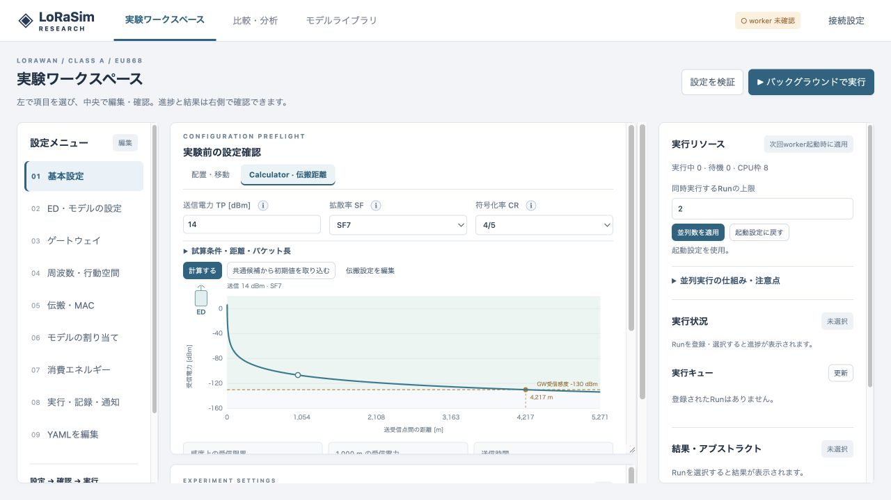
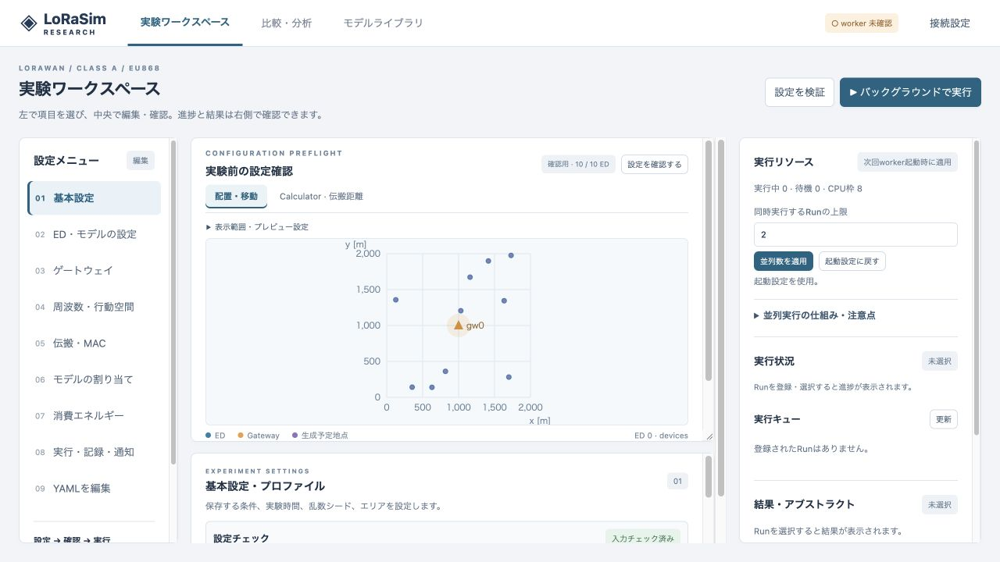

# v0.9.2 GUI修正・検証記録

2026-10-19。変更前は `50c0563`（v0.9.1）。Calculatorの表示不具合と、配置プレビューが横方向へ引き伸ばされる問題を修正した。PHY/MAC・移動モデル・選択器・Calculatorの計算式は変更していない。

## 原因と修正

### Calculatorが開かない

新しいHTMLと、Calculator実装前のJavaScript/CSSを同時に表示すると、タブは存在するがクリックしても切り替わらず、タブのスタイルも旧表示になる。添付画面と一致する症状をローカルブラウザーで再現した。利用者のサーバーや実ブラウザーのキャッシュ自体は調査していないため、当該環境の原因を断定するものではない。

`lorasim/web_assets.py` で画面配信をまとめ、以下を適用した。

- HTMLは `Cache-Control: no-store`。スクリプトとCSSは内容のSHA-256から生成したクエリをURLに付ける。
- ZIP展開時にファイルのサイズ・更新日時が同じでも、内容が変わればURLを変える。
- 静的ファイルは再検証を要求する。`/static/index.html` の直接アクセスも版付きURLを含む `/` へ戻す。
- Calculatorは初めてタブを開くときに初期化し、読み込みに失敗した場合は日本語の説明と再読み込み・更新のヒントを表示する。

ページの読込時だけファイルのハッシュを計算する。シミュレーションイベントやポーリングの負荷には追加しない。

### 配置プレビューが横長になる

従来は1000×360のCanvasを異なる縦横比でCSS表示し、さらにxとyを別々の縮尺で描画していた。`lorasim/static/preview-map.js` へ描画と選択判定を分離し、以下を修正した。

- x・yを同じメートル／ピクセルの縮尺にする。正方形エリアは正方形、長方形エリアは実際の比率で表示する。
- 描画サイズを表示領域と画面のピクセル倍率に合わせる。余白を許容し、文字・マーカーを伸ばさない。
- リサイズ・再表示で再描画する。EDクリックも同じ座標変換を使う。
- 再描画要求は1フレーム内にまとめ、プレビューOFF・別ツール・別画面・ブラウザー非表示では描画しない。

## 自動テスト

- macOS arm64 / Python 3.11.4：**262 passed**、9.37秒。[ログ](../validation/tests-ui-fix-native.txt)。既存Starlette TestClientの非推奨警告1件。
- Node.jsの標準テストランナー：**6 passed**。[ログ](../validation/tests-ui-fix-node.txt)。追加のnpm依存なし。
- 全画面スクリプトの構文チェックと `git diff --check` 通過。

API側の追加3件は、HTML／静的ファイル／304応答のキャッシュ契約、内容ハッシュ、同サイズ・同更新日時での更新、直接HTML参照、スクリプトの依存順序を検証する。

描画側の6件は、正方形・横長・縦長のエリアでの等縮尺、表示領域への収まり、ピクセル倍率1／2／3、リサイズと移動後の描画地点・クリック判定の一致を検証する。

```bash
python -m pytest -q
node --test tests/ui/preview-map.test.cjs
```

## ブラウザー検証

ローカル専用サーバーで、以下の順に確認した。検証中に本実験のRunは作成していない。

1. v0.9.1のHTMLと、v0.9のJavaScript/CSSを配信する再現ページを用意し、旧ファイルに1時間のキャッシュ期限を付けた。Calculatorクリック後もタブが選択されず、横長の配置図が残る現象を再現した。
2. 同一オリジン・同一タブのまま、キャッシュを削除せず修正版へ移動した。Calculatorが開き、入力フォーム・受信電力曲線・距離結果が表示された。
3. TP14 dBm、SF7、CR4/5で受信限界4,217 mを表示。SF12に変更すると9,066.6 mへ再計算された。
4. 「配置・移動」に戻すと2000 m×2000 mのエリアを正方形で表示。点と文字が引き伸ばされないことをスクリーンショットで確認した。
5. 図上のEDをクリックし、選択表示がED 0からED 9へ変わることを確認した。表示270×240 CSS pxに対しCanvasは540×480 px（倍率2）。ブラウザーのerror／warnログは空だった。





## 更新方法と適用範囲

修正版ソースにはAPI側と画面ファイル側の両方の変更が含まれる。APIを含む配布物を更新・再起動してから、ブラウザーを通常の方法で再読み込みする。新しい画面ファイルだけを旧APIの配信フォルダーへコピーする方法では、キャッシュ制御の修正は有効にならない。

Docker Composeでは、実行中の実験が完了してから通常の更新コマンドを使う。

```bash
docker compose up -d --build
```

稼働中のサーバーへのデプロイ、Ubuntu実機・GPUでの再検証は今回行っていない。これは表示・配信処理の修正であり、無線シミュレーションの高速化や結果変更は含まない。
