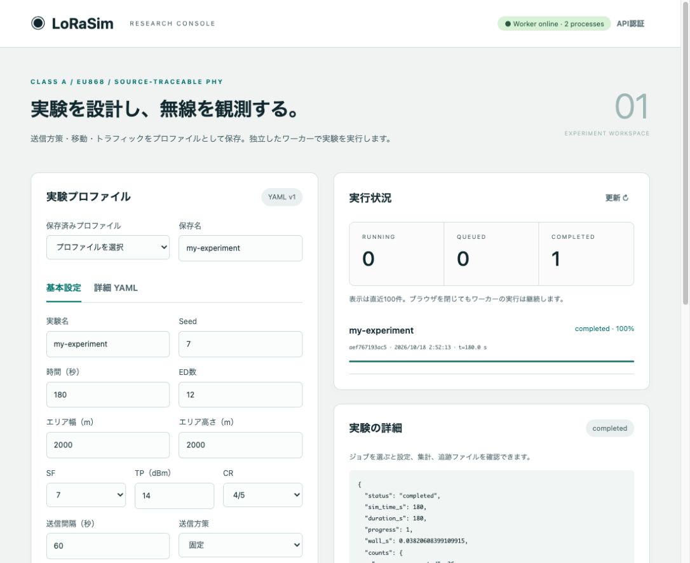

# 検証記録

## v0.2追加検証（2026-10-18）

- ローカルPythonテスト **76 passed**: [pytest-v02.txt](../validation/pytest-v02.txt)。既存61件に加え、再利用参照、ADR履歴・backoff・下り喪失・要求ビット、BADR列、無線状態積分、MCU分離、未送信推論、ED平均、送信回数フィルタ、公平性、Experiment分離、描画の無副作用を検証。
- 実上流の無線消費電力10ケースが一致。TX電流8ケースと全状態積分2ケース。最大絶対誤差1.6653e-16: [energy-result.json](../validation/energy-result.json)。
- 既存PHY参照の144 ToA / 7伝搬 / 864干渉 / 8 GWケースも再照合して成功。
- 同梱6プロファイルを全て完走。GUIからモデル保存、外部定義を展開したプロファイル読込、検証、Run投入、結果表示を実機ブラウザで確認。3 Experiment / 9 Runの範囲集計・MCU切替も確認。
- Ubuntu 22.04 / linux/amd64のCPUイメージを再ビルド。BuildKit RUNのテスト結果: [docker-v02-test.log](../validation/docker-v02-test.log)。Compose CPU/GPU構成検証も成功。
- v0.2性能は同じ1,000 ED / 12,000 ULシナリオでPython中央値2.0043秒、ns-3中央値4.0851秒（約2.04倍）。無線電力追跡と終了時分析も有効。全3回とも12,000送信・12,000受信。[benchmark-v02.json](../validation/benchmark-v02.json)。この小規模・決定的ケースの実測であり、全シナリオやNVIDIA上の性能保証ではありません。


以降はv0.1時点の検証記録です。旧版のテスト数・速度をv0.2の性能値として使用しないでください。


## 実施環境

2026-10-18、macOS 26.3.1 / arm64、Python 3.11.4、AppleClang 17。別途、Ubuntu 22.04 / linux/amd64コンテナ内（BuildKit RUN、Apple Silicon上のエミュレーション）でもPython 3.10.12で61件が通過しました。ユーザー指定のLinuxカーネル5.15.0-190-generic上の実機とNVIDIA GPUでは未実行です。依存版は [python-environment.txt](../validation/python-environment.txt) にあります。

## 上流実体との比較

上流をチェックアウトし、ns-3.48のreleaseビルドで実際のC++関数を呼ぶ [ns3-oracle.cc](../validation/ns3-oracle.cc) をコンパイルしました。Pythonの式を書き写したC++を「正解」とする方法ではありません。

- Time-on-Air: 6 SF × 4 CR × 6 payloadサイズ = **144条件**。整数nsで一致。
- LogDistance + ConstantSpeed delay: **7距離**。受信電力絶対誤差<1e-10 dB、整数ns遅延一致。
- Goursaud interference: 6希望SF × 6干渉SF × 6電力差 × 4重複開始時刻 = **864条件**。破壊するSF一致。
- GW受信: 感度、同時復調器不足、同SF干渉、DL開始時の中断の4シナリオ／**8受信結果**。参照出力を取得し、同じケースをPythonエンジンの`tests/test_reference.py`でも検証。

参照出力は [oracle.csv](../validation/oracle.csv)、比較結果は [oracle-result.json](../validation/oracle-result.json)。上流自身の`./test.py --suite=lorawan --no-build`も **PASS** でした。

ビルド時、上流`model/logical-lora-channel.cc`がNS_LOGマクロを使用する一方で`ns3/log.h`を直接includeしておらず、この環境ではビルドエラーになりました。比較用チェックアウトに`#include "ns3/log.h"`のみを追加しました。式・定数・判定・イベント処理は変更していません。再現スクリプトにもこのincludeを明示しています。

```bash
pip install -e '.[test]'
# C++コンパイラ、git、CMake、Ninjaが必要。上流を新しい作業場所へ取得。
python validation/reproduce.py --work /tmp/lorasim-reference --jobs 4
# 保存済みの参照出力だけを再比較する場合
python validation/compare_oracle.py validation/oracle.csv
```

これらはPHYの限定された差分検証です。全MACイベント軌跡、全LoRaWAN仕様、任意シナリオの等価性を証明するものではありません。[FIDELITY.md](FIDELITY.md)の差分が適用されます。

## Pythonの機能検証

**61件のテストが成功（2.37秒）**。`pytest -q`でPHY式、SF境界、Class A ACK、再送、RX2フォールバック、失敗ACKのRX2再送抑止、GW送信中断、感度以下信号の干渉寄与、復調器数、Duty Cycle、終了打ち切り、移動、条件割当、観測漏洩防止、NumPy/scalar伝搬の一致、分割Parquet、キャンセル、API認証、ファイルパストラバーサル、プロファイル保存、独立並列ワーカー、curl通知を検証しました。最新実行結果は [pytest-result.txt](../validation/pytest-result.txt) を参照してください。

4つのYAML実行例も全件完了し、全Parquetをバッチで再読込しました。結果は [examples-result.json](../validation/examples-result.json) に保存しています。

GUIは実ブラウザから入力検証、プロファイル保存、ジョブ投入、running→completed、100%進捗、集計、結果ファイル一覧を確認しました。



## 性能測定

[benchmark-result.json](../validation/benchmark-result.json)に3回ずつの実測値を保存しています。条件は、静止ED1,000台、GW1台、3,600 simulated seconds、20-byte application payload、SF7/CR4/5、868.1 MHz、送信間隔300秒、EDごとの初回時刻0.1秒間隔、Duty Cycle有効、未確認UL、ADR無効です。

両実装とも **12,000 UL送信 / 12,000 GW受信成功**。これは衝突の少ない決定的な基準ケースです。結果の一致を移動・学習・高密度衝突条件へ一般化できません。

3回の中央値は **Python 0.739秒、ns-3 4.247秒（この条件で約5.75倍）** でした。Pythonのプロセス最大RSSはおよそ100 MiBでした（詳細はJSON）。Pythonは全トラッキングをParquet出力し、ns-3側はPHY送受信カウンターのみを記録しています。Pythonのrunはmanifest等の準備後から、ns-3はSimulator::Run部分を計測。初期構築・プロセス起動を除外しています。Pythonには進捗JSON書き込みを含みますが、最終flushの時間はsummary.wall_sに含まれます。最後のpolicy_state保存は含みません。バックグラウンドのGUI/APIは両者の測定中に起動していました。

速度差の主因は、Pythonそのものではなく、EDへの受信不能なULコールバックを省略し、干渉を同じ式で累積する処理構成の違いです。一つの実験は依然として逐次イベント処理です。独立実験の並列実行は別に利用できます。

```bash
python scripts/benchmark.py --n 1000 --duration 3600 --output runs/bench
# スカラー版との比較
python scripts/benchmark.py --n 1000 --duration 3600 --backend scalar --output runs/bench-scalar
# ns-3を再現スクリプトで準備した後
cd /tmp/lorasim-reference/ns3
./ns3 run --no-build lorasim-benchmark
```

Ubuntu/x86-64実機での速度、CUDA推論、大量DL・大量移動時の性能は未測定です。Pythonがあらゆる条件でns-3より高速とは主張しません。

## Dockerと切断耐性

CPUイメージのビルド成功、CPU/GPU両Compose構成の`config --quiet`成功、Ubuntu 22.04 / linux/amd64のBuildKit RUN内で **61 passed（11.58秒）** を確認しました。[docker-test-result.txt](../validation/docker-test-result.txt)にログを保存しています。DockerfileではUbuntu標準の古いpip/setuptoolsによるmetadata認識問題を避けるため、パッケージングツールを更新し、`lorasim --help`もビルド中に検証します。

```bash
docker build -t lorasim-research:local .
docker build -f validation/Dockerfile.test -t lorasim-research:test .
```

Docker Desktopの通常コンテナ開始はCreatedのまま停止したため、Compose本起動は未確認です。`/bin/true`のみの対照コンテナでも再現し、原因は不明です。daemon設定や既存コンテナを変更せず、作成した検証用コンテナだけを削除しました。

ローカルmacOSではAPIへジョブ投入直後（queued）にAPIプロセスを停止し、独立ワーカーが12,000 ULの実験をcompletedへ進めることを確認しました。[native-detach-result.json](../validation/native-detach-result.json)に記録しています。GPUイメージのビルド／CUDA実行は未検証です。
